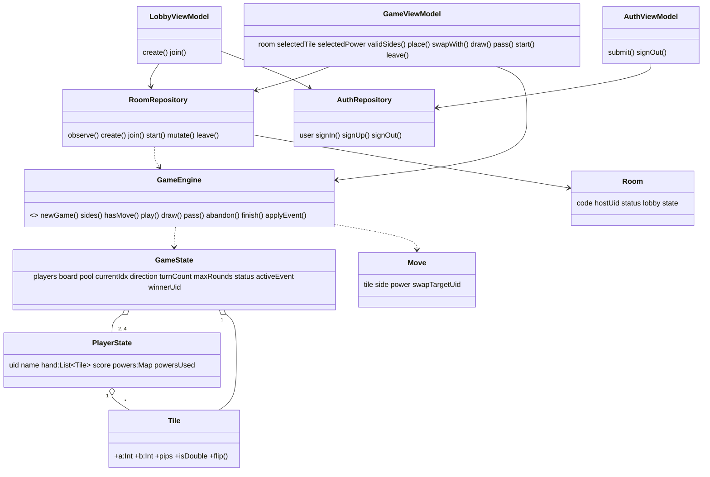

# Informe – Dominó "Caos"
Universidad Distrital Francisco José de Caldas · Tecnología en Sistematización de Datos
Integrantes: _(completar)_ · Curso: _(completar)_ · Fecha: _(completar)_

## 1. Especificaciones de diseño
**Objetivo.** Juego de dominó multijugador (2–4) por salas, con poderes limitados y eventos aleatorios que alteran las reglas temporalmente. Estado sincronizado en tiempo real con Firebase.

**Reglas implementadas**
| Regla | Implementación |
|---|---|
| 7 fichas por jugador, resto al pozo | `GameEngine.newGame` (set doble-6 de 28 fichas) |
| Turnos y sentido | `GameState.currentIdx`, `direction` (+1 / −1) |
| Movimiento válido | `GameEngine.sides()` / `play()` validan extremos y orientan la ficha |
| Sin jugada → robar; pozo vacío → pierde turno | `draw()`, `pass()` y pase automático en `settle()` |
| Puntaje | pips de la ficha (+2 si es doble), ×2 con evento *Puntos dobles*, +10 al quedarse sin fichas |
| Fin de partida | mano vacía, partida bloqueada (todos pasan) o máximo de rondas |
| Ganador | mayor puntaje; empate → menos poderes usados; si persiste → empate |
| Abandonar / reiniciar | `abandon()` (gana el mejor rival) / `RoomRepository.start()` (solo anfitrión) |

**Poderes (usos limitados, se elige antes de mover):** Comodín ×2 (ignora la coincidencia de extremos), Salto ×1 (el siguiente pierde turno), Intercambio ×1 (cambia una ficha propia por una al azar del oponente elegido; consume el turno), Inversión ×1 (invierte el sentido).

**Eventos aleatorios** (cada 3 turnos, 60 % de probabilidad): Puntos dobles (3 turnos), Poderes congelados (3 turnos), Inversión de sentido, Salto del siguiente, Robo forzado del siguiente, Rotación de manos, Reducción del pozo en 2. Afectan fichas, turno, puntaje y pozo.

## 2. Arquitectura MVVM
```
 View (Compose)  ──eventos──▶  ViewModel  ──llama──▶  Repository ──▶ Firestore / Auth
 screens+components ◀─estado──  (Auth/Lobby/Game)        │
                                      │                  ▼
                                      └──────────▶  GameEngine (dominio puro)
```
- **Model:** `domain/` (datos y reglas) + `data/` (persistencia remota).
- **ViewModel:** guarda la selección (ficha, poder), valida localmente con el motor y delega en el repositorio. No contiene reglas de juego.
- **View:** composables sin lógica; reciben estado y lambdas.
- **Tiempo real:** `RoomRepository.observe()` expone un `Flow` con `addSnapshotListener`; cada jugada se escribe con `runTransaction` (lee estado → `GameEngine` → escribe), evitando condiciones de carrera.

## 3. Diagrama de clases


## 4. Componentes de la interfaz
| Componente | Función |
|---|---|
| `DominoTile` | Ficha dibujada con `Canvas` (puntos); reutilizada en tablero y mano |
| `BoardView` | Cadena de fichas en tiempo real con scroll automático |
| `HandView` | Mano del jugador con selección |
| `PlayerCard` | Nombre, puntaje, fichas, poderes usados y turno actual (siempre visible) |
| `PowerBar` | Chips de poderes con usos restantes |
| `ControlsBar` | Colocar izquierda/derecha, robar, pasar |

Pantallas: `AuthScreen` (login/registro), `LobbyScreen` (crear/unirse), `RoomScreen` (espera, partida, resultados).

## 5. Flujo de la partida
1. Anfitrión crea sala → otros se unen con el código → anfitrión inicia.
2. En su turno el jugador (opcional) elige un poder, elige ficha y lado (o robar/pasar).
3. `GameEngine.play` valida, actualiza tablero, mano, poderes y puntaje; avanza el turno; puede disparar un evento.
4. El estado se escribe en Firestore y todos los clientes se actualizan.
5. Al cumplirse una condición de fin se calcula el ganador; el anfitrión puede reiniciar.

## 6. Pruebas unitarias (`GameEngineTest`, 18 casos)
Reparto inicial, turno, colocación/orientación, movimiento inválido, Comodín, poderes congelados, Salto, Inversión, Intercambio, robo del pozo, partida bloqueada, fin por mano vacía, fin por rondas, desempate, eventos, puntos dobles y abandono.

## 7. Decisiones y limitaciones
- Estado completo en un documento de Firestore (simple y consistente gracias a transacciones). Las manos son visibles en el documento: adecuado para un trabajo académico; en producción se separarían manos privadas por jugador con reglas de seguridad.
- Inicio de sesión con correo/contraseña; Google queda como extensión opcional.
